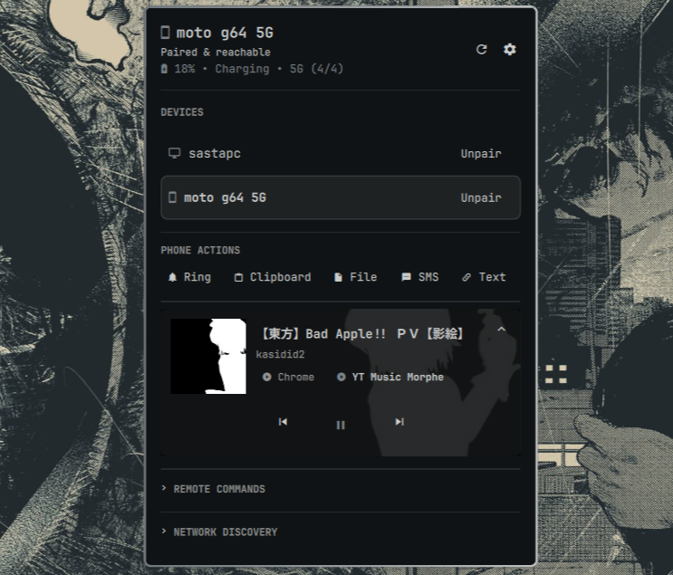
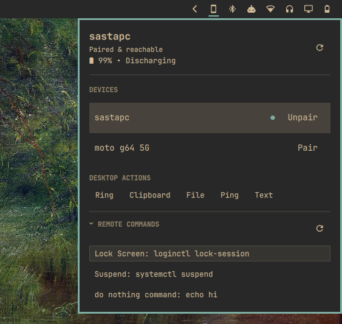

# OmaConnect

Control phones and connected devices from the Omarchy bar using KDE Connect.



## Install
Just install the plugin with this command. It will handle dependencies and firewall in GUI.
```bash
omarchy plugin add https://github.com/jitendradara12/omaconnect.git --enable --yes
```

## Features

- **Device status.** Battery level, charging state, cellular network type, signal strength, and reachability.
- **Quick actions.** Ring phone, sync clipboard, send files, share text or links, and ping devices.
- **SMS launcher.** Open `kdeconnect-sms` for paired devices.
- **Media playback.** Track metadata, playback controls, and player switching.
- **File picker.** Pick recent files with `omarchy-menu-select`.
- **Remote commands.** Run custom commands configured on paired devices.
- **Pairing.** Manage requests, verification keys, and unpairing.
- **Network discovery.** Add Tailscale peers or custom LAN and VPN IP addresses.
- **Bar widget.** Show connection and battery status directly in the Omarchy bar.

## Preferences

Configure OmaConnect in Omarchy bar widget settings.

| Setting | Default | Description |
|---|---|---|
| `showBatteryStats` | `true` | Battery percentage and charging state |
| `showBarBattery` | `false` | Battery percentage next to the icon in the bar |
| `showNetworkStats` | `true` | Cellular network type and signal strength |
| `showTailscale` | `true` | Tailscale and custom IP discovery |
| `showDeviceTypeIcons` | `true` | Device type icons in bar and panel |
| `showMediaPlayer` | `true` | Media player controls and track metadata |
| `showRemoteCommands` | `true` | Remote commands section |
| `showTroubleshooting` | `true` | Setup and firewall helpers when offline |
| `showActionRing` | `true` | Ring device button |
| `showActionClipboard` | `true` | Clipboard sync button |
| `showActionFile` | `true` | File transfer button |
| `showActionSms` | `true` | SMS launcher button |
| `showActionPing` | `false` | Ping button |
| `showActionText` | `true` | Text and link share button |
| `defaultPingMessage` | `""` | Default ping message draft |

## Shortcuts

(Optional) Add to `~/.config/omarchy/shortcuts.lua`:

```lua
o.bind("SUPER + SHIFT + C", "Toggle OmaConnect", "omarchy-shell shell toggle omaconnect")
```

## Dependencies

Requires `kdeconnect`, `glib2`, `dbus`, and `omarchy-menu-select` (for file sharing). `tailscale` and `kdeconnect-sms` are optional.

```bash
sudo pacman -S --needed kdeconnect glib2 dbus
```

### Tailscale and custom IPs

Expand **Network Discovery** to add detected Tailscale peers, or enter custom LAN and VPN IP addresses directly.

### Firewall

KDE Connect requires ports `1714:1764` (TCP and UDP). Click **Allow in Firewall** in the panel when devices are offline, or allow them manually:



```bash
sudo ufw allow 1714:1764/tcp comment 'KDE Connect'
sudo ufw allow 1714:1764/udp comment 'KDE Connect'
sudo ufw reload
```

## Update

```bash
omarchy plugin update omaconnect
```

## Remove

```bash
omarchy plugin remove omaconnect
```

## Development / running tests

Run the full validation pipeline (python unit tests, bash tests, shell syntax, and the optional shellcheck/qmllint stages when those tools are installed):

```bash
bash scripts/validate.sh
```

Tests follow two conventions and are discovered automatically, so no list needs updating when tests are added:

- `tests/test_*.py` — python `unittest` tests: `python3 -m unittest discover -s tests -p 'test_*.py' -q`
- `tests/*.test.sh` — zero-dependency bash tests: `bash tests/<name>.test.sh`

CI (`.github/workflows/ci.yml`) runs `scripts/validate.sh` plus the two commands above directly as a second net. The Quickshell QML runtime cannot run headless (it needs a compositor, the omarchy-shell engine, and a KDE Connect daemon), so CI covers the bash and python tests plus shell syntax, and the QML files get a `qmllint` syntax check only.

## Privileged actions

Two scripts used by the panel's troubleshooting helpers run with `sudo`:

- `scripts/setup_firewall.sh` opens the KDE Connect ports with `ufw` or `firewalld`.
- `scripts/install_dependencies.sh` installs packages with `pacman`.

Both print the commands they run and need an interactive terminal for the `sudo` password prompt — always run them from a terminal and review the printed commands before confirming. Everything else in the plugin, tests included, runs unprivileged.

## Star History

<a href="https://www.star-history.com/?repos=jitendradara12%2Fomaconnect&type=date&releases=&legend=bottom-right">
 <picture>
   <source  srcset="https://api.star-history.com/chart?repos=jitendradara12/omaconnect&type=date&legend=bottom-right" />
   
 </picture>
</a>
